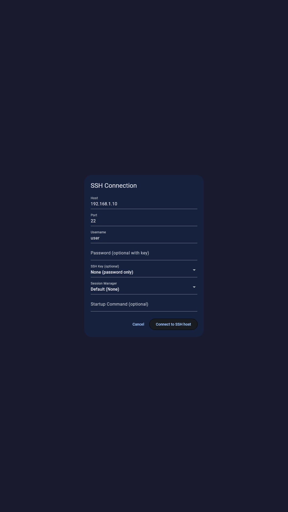

# fdroiddata App Inclusion MR description (paste into GitLab)

Use this as the **MR description body** (not a comment). Title format:
`New App: com.involvex.ssh_app_flutter`

After pasting, tick every checklist item in the GitLab UI if checkboxes render,
then ask linsui (or reopen) with a short note that the App Inclusion template
is now filled and uniqueness is addressed.

Related: closed MR https://gitlab.com/fdroid/fdroiddata/-/merge_requests/59275
RFP: https://gitlab.com/fdroid/rfp/-/work_items/4880

---

## Abstract

### Please introduce the functions and usage of your app in summary, and also attach some screenshots.

PocketShell is a FOSS Android SSH/SFTP client aimed at phones used as a daily
driver against **Windows and Linux hosts**. You save profiles (password or
private key), open multi-session terminals with a customizable shortcut bar,
browse/upload/download over SFTP (including Windows drive letters), import
OpenSSH `~/.ssh/config` IdentityFiles over SFTP, and keep sessions alive in the
background via a foreground service.

It also includes a native **Agents** tab that talks to a **self-hosted OpenCode**
HTTP API on the same machine as the SSH profile (no WebView, no PocketShell
backend). Optional terminal “wand” AI is NonFreeNet and only runs after you
paste an API key and tap generate.

Screenshots (Fastlane on tag v1.4.2):

Source: https://github.com/involvex/pocketshell  
License: MIT · Application ID: `com.involvex.ssh_app_flutter` · Tag: **v1.4.2**

### Please elaborate why you wrote this app. Please highlight the unique functions it provides over other similar apps in F-Droid.

I wrote PocketShell because my primary workflow is an Android phone talking to
**Windows** hosts for SSH, SFTP, and a self-hosted OpenCode coding agent. I am
the upstream author.

F-Droid already has strong SSH clients (e.g. ConnectBot, Conduit, PaperTerm).
PocketShell is not a ConnectBot clone. The gaps it fills:

1. **Native OpenCode Agents client** — master-detail chat against OpenCode V2
   (`/api/*`) on the profile host, with SSH local-forward tunneling to loopback
   OpenCode, remote `opencode.json` import/write over SFTP, and slash commands
   (`/agent`, `/model`, `/models`, `/connect`). No other F-Droid SSH app ships
   this.
2. **Windows-oriented SFTP** — drive probing `C:/`–`Z:/`, share-intent
   **upload-to-host** queue, and share-to-clone paste for git URLs.
3. **OpenSSH config import with IdentityFile PEM pull** over SFTP after merge
   (encrypted/missing keys become hints; PEMs are never logged).
4. **Android home-screen widgets** for SSH quick-connect and resume of the most
   recently updated agent session (`sshapp://widget/...` deep links).
5. **Daily-driver session UX** — jump hosts, labeled local port forwards (RDP
   preset), biometric app lock + `FLAG_SECURE`, host-key fail-closed trust
   dialog, bundled OFL fonts (no Google Fonts CDN), `allowBackup=false` with
   FlutterSecureStorage backup excludes.

Optional cloud AI wand is disclosed as **NonFreeNet** and is unused unless the
user supplies a key. Self-hosted Agents traffic stays on the profile host.

## Checklist

### Policy

* [x] The app complies with the [inclusion criteria](https://f-droid.org/docs/Inclusion_Policy/).
* [x] The original app author has been notified (and does not oppose the inclusion). **I am the author.**
* [x] The upstream app source code repo contains the app metadata in a Fastlane folder structure at `fastlane/metadata/android/en-US/` (title, short/full description, changelogs, icon, featureGraphic, phoneScreenshots) plus `PRIVACY.md`.

### Docs

* [x] Please read the [guide](https://f-droid.org/docs/Submitting_to_F-Droid_Quick_Start_Guide/) first.
* [x] Please make sure your metadata follows the best practice in our [templates](https://gitlab.com/fdroid/fdroiddata/-/tree/master/templates).
* [x] Please read the [Build Metadata Reference](https://f-droid.org/docs/Build_Metadata_Reference/).
* [x] Please read the [Quick Start Guide](https://f-droid.org/docs/Submitting_to_F-Droid_Quick_Start_Guide/).

### Merge Request Setup

* [x] The title of this merge request follows the "New App: …" / application-id format.
* [x] The fdroiddata fork is public and the branch is not protected (`Involvex/fdroiddata`, branch `com.involvex.ssh_app_flutter`).
* [x] Related issues referenced: RFP https://gitlab.com/fdroid/rfp/-/work_items/4880 (this MR supersedes the closed description on !59275).
* [x] Only one app in this MR.

### Metadata

* [x] Metadata is in `metadata/com.involvex.ssh_app_flutter.yml`.
* [x] Metadata is valid YAML (`fdroid rewritemeta` / lint / schema passed on fork CI).
* [x] Metadata uses LF line endings.
* [x] Summary/description/changelog/images come from upstream Fastlane (not duplicated unnecessarily in fdroiddata).
* [x] Releases are tagged (`vMAJOR.MINOR.PATCH`); first listing builds **v1.4.2** only (ABI versionCodes 161/162/163).
* [x] Issue tracker and contact: https://github.com/involvex/pocketshell/issues
* [x] `AuthorName: involvex` is set.
* [x] No external git submodules required (Flutter via `srclibs`; vendored `packages/home_widget` in-tree).
* [x] ABI-split builds are configured (`versionCode * 10 + ABI`) because Flutter APKs are large with native libs.
* [x] Only the listing versions for v1.4.2 are in the metadata for first inclusion.
* [x] No disabled versions.
* [x] Prefer full commit hash when packagers rewrite `commit:` from the tag.

### Pipeline

* [x] Fork CI previously passed on this branch (`fdroid build`, `check apk`, `rewritemeta`, lint) at `76c94682` before close; please re-run after description fix / reopen.
* [x] Scanner notes: recipe enables R8 minify, excludes `com.google.android.play` (Flutter deferred-components stubs), strips foojay-resolver, sets Gradle `distributionSha256Sum` for the tag wrapper.
* [x] AntiFeature **NonFreeNet** documented for the optional wand only; Agents → self-hosted OpenCode on the profile is not NonFreeNet.
